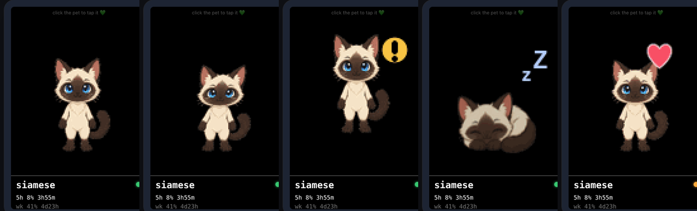

# siamese pack: provenance and license

A Siamese desk-pet pack, a sibling to `bufo` and the cats. It uses the same `manifest.json` schema,
the same 96×100 frame format and the same AnimatedGIF decoder. The whole pack is 116 KB.



## Source art

| Asset | Source | License |
|---|---|---|
| Siamese cat character (one front-facing image) | Drawn by OpenAI Codex `image_gen` (`codex exec`), 2026-10-21, at Nat's request | AI-generated, no third-party art |
| Sleeping pose (`sleep-src.png`) | A second Codex `image_gen` drawing of the same cat curled up asleep, with the first image as reference | AI-generated, no third-party art |
| Every other animation frame | Bent from that single image by the 2D puppet rig in [laris-co/nexus-oracle `ψ/lab/sprite-one-image`](https://github.com/laris-co/nexus-oracle/tree/main/%CF%88/lab/sprite-one-image) (nexus-oracle#130, PR #131) | original |
| Heart, "!" badge, "z Z" | Drawn by `build-siamese-pack.sh` (the heart is the same path as cat-orange's) | original |

This is a generated character, not a photo of a real cat. The rig bends one drawing; it does not
redraw poses, so arms do not swing and there is no side view. Sleep is the exception: bending the
standing cat gave a crouch with open eyes, so sleep has its own drawing.

## State mapping

| state | motion | frames |
|---|---|---:|
| `idle` | breathing squash | 8 |
| `busy` | an easy jog: small bounce and lean | 10 |
| `attention` | one small hop, then a breath, with a steady yellow "!" | 14 |
| `sleep` | the curled-up drawing breathing on the same baseline, dimmed 15%, "z Z" drifting up | 8 |
| `heart` | idle plus a rising heart | 8 |
| `celebrate` | jump: crouch, airborne, land | 12 |
| `dizzy` | ±12° sway about the feet | 8 |

Every state uses one crop box, so the cat stays the same size when it changes state. Busy and attention
were first made big (they looked like idle at 96 px), then calmed: the fast double hop was too
dizzying next to a desk all day.

## Whole frames, on purpose

Every GIF stores whole 96×100 frames with no transparent index (not `gifsicle -O3`). `GIFDraw` in
`jc3248-pet-idf/main/gif.cpp` paints a transparent pixel with `s_bg` rather than leaving the
previous frame in place. With delta frames, every pixel that did not change between frames turned
black, which showed as black specks in the cat on the real device (2026-10-21). The other packs
are built with `-O3`, and `cat-orange/busy.gif` has 9 transparent frames, so they may show the same
specks.

## Use

```bash
cp -R lab/buddy/characters/siamese lab/jc3248-pet-idf/data/characters/   # firmware storage image
./lab/jc3248-pet-idf/tools/build-packs.sh siamese                          # app .bin for this pack

# preview without hardware
mkdir -p lab/jc3248-pet/data/characters && cp -R lab/buddy/characters/siamese lab/jc3248-pet/data/characters/
cd lab/jc3248-pet && python3 -m http.server 8080
open 'http://localhost:8080/sim/pet-sim.html?pack=siamese'
```

## Rebuild

`render-frames.mjs` renders each state's frames from the rig page in ego lite. `build-siamese-pack.sh`
then crops, scales, adds the overlays and optimizes the GIFs. See the comments at the top of each
file.
